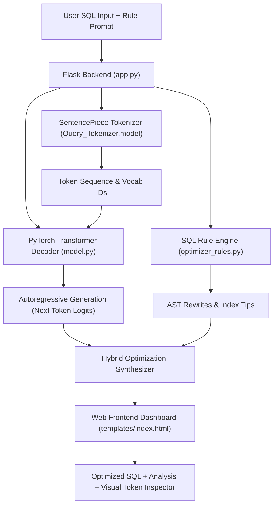

# ⚡ Query-Optimizer: Neural & Rule-Based SQL Optimization Engine

[](https://www.python.org/)
[](https://pytorch.org/)
[](https://flask.palletsprojects.com/)
[](LICENSE)

An end-to-end SQL query optimization and database performance diagnostic platform. **Query-Optimizer** merges a custom-trained **PyTorch Transformer Decoder (GPT Architecture)**, a custom **SentencePiece Tokenizer**, and an **Expert SQL Rule Engine** into a unified, responsive **Flask Full-Stack Web Application**.

---

## 📑 Table of Contents

- [Overview](#-overview)
- [Architecture & Neural Specifications](#-architecture--neural-specifications)
- [Key Features](#-key-features)
- [System Pipeline](#-system-pipeline)
- [Repository Structure](#-repository-structure)
- [Installation & Quickstart](#-installation--quickstart)
- [REST API Reference](#-rest-api-reference)
- [Model Training & Checkpoints](#-model-training--checkpoints)
- [License](#-license)

---

## 🌟 Overview

Database query optimization is traditionally split between manual query rewriting and database cost-based optimizers. **Query-Optimizer** bridges machine learning and database heuristics:

1. **Neural SQL Generation**: Uses a 6-layer Transformer Decoder to learn semantic query rewrites and optimization patterns directly from SQL syntax pairs.
2. **Heuristic Rule Engine**: Detects common database anti-patterns (such as correlated `IN` subqueries, unbounded `SELECT *`, redundant `DISTINCT`, and unindexable leading-wildcard `LIKE` patterns).
3. **SentencePiece Subword Tokenizer**: Custom 375-token subword vocabulary trained directly on SQL queries, clauses, tables, and attributes.
4. **Interactive Dashboard**: Modern UI offering side-by-side SQL comparisons, interactive tokenizer inspections, and execution metrics.

---

## 🧠 Architecture & Neural Specifications

The model (`GPTStructure`) follows a causal autoregressive Transformer Decoder architecture:

| Hyperparameter | Value | Description |
| :--- | :--- | :--- |
| **Model Type** | Decoder-Only Transformer | Causal masked autoregressive language model |
| **Layers ($N$)** | 6 | Stacked Decoder blocks |
| **Attention Heads ($h$)** | 4 | Multi-Head Self-Attention with causal upper-triangular masking |
| **Embedding Dim ($d_{\text{model}}$)** | 256 | Hidden representation size |
| **Feed-Forward Dim ($d_{\text{ff}}$)** | 1024 | 4x expansion with SiLU activations |
| **Dropout** | 0.1 | Regularization across residual layers and attention |
| **Vocabulary Size** | 375 | Custom SentencePiece subword vocabulary |
| **Total Parameters** | **4,934,007** | Trainable parameters |
| **Max Sequence Length** | 140 | Maximum token context window |
| **Positional Encoding** | Sinusoidal | Fixed trigonometric positional encodings |

### Mathematical Formulation

* **Positional Encoding**:
  $$PE_{(pos, 2i)} = \sin\left(\frac{pos}{10000^{2i/d_{\text{model}}}}\right)$$
  $$PE_{(pos, 2i+1)} = \cos\left(\frac{pos}{10000^{2i/d_{\text{model}}}}\right)$$

* **Causal Attention**:
  $$\text{Attention}(Q, K, V) = \text{softmax}\left(\frac{QK^T}{\sqrt{d_k}} + M\right)V$$
  where $M_{i,j} = -\infty$ for $j > i$ (preventing attending to future tokens).

---

## 🚀 Key Features

* **Three Execution Modes**:
  * ⚡ **Hybrid Mode (Recommended)**: Synthesizes neural transformer suggestions with deterministic AST safety rules.
  * 🤖 **Neural Transformer**: Pure PyTorch autoregressive decoding through the trained weights.
  * 🛡️ **Rule Engine**: Fast, deterministic SQL transformations (e.g. converting `IN (SELECT ...)` to `EXISTS` or `JOIN`, safety `LIMIT` insertion, and index-only scan recommendations).
* **Interactive SentencePiece Inspector**:
  * Visually highlights how SQL statements are tokenized into subwords.
  * Displays token IDs, piece names, and vocabulary stats from `Query_Tokenizer.model`.
* **SQL Formatter & Beautifier**:
  * Automatically capitalizes SQL keywords and structures queries with standardized indentation.
* **Pre-Loaded Test Suite**:
  * One-click presets for common query bottlenecks: Correlated Subqueries, Full Table Scans (`SELECT *`), Leading Wildcards, Redundant `DISTINCT`, and Multi-Table Joins.

---

## 🔄 System Pipeline



---

## 📁 Repository Structure

```
Query-Optimizer/
│
├── app.py                   # Flask server exposing REST API & serving web UI
├── model.py                 # PyTorch GPTStructure, decoder layers & inference engine
├── optimizer_rules.py       # Deterministic SQL AST optimizer & heuristic rule engine
├── tokenizer_utils.py       # Dual native & pure-Python SentencePiece tokenizer loader
├── test_app.py              # Automated test suite for API endpoints and engine logic
├── requirements.txt         # Project dependencies (Flask, PyTorch, SentencePiece)
├── README.md                # Comprehensive documentation
├── .gitignore               # Ignored artifacts (cache, checkpoints, logs)
│
├── Query_Tokenizer.model    # Trained SentencePiece binary tokenizer model
├── Query_Tokenizer.vocab    # Vocabulary mapping (375 subword tokens & log probs)
├── model (1).ipynb          # Jupyter notebook containing training loops & dataset prep
│
└── templates/
    └── index.html           # Full-featured responsive web dashboard (Tailwind + HLJS)
```

---

## 🛠️ Installation & Quickstart

### 1. Clone the Repository

```bash
git clone https://github.com/shrmadishant-coder/Query-Optimizer.git
cd Query-Optimizer
```

### 2. Install Dependencies

```bash
pip install -r requirements.txt
```

### 3. Run the Verification Tests

```bash
python test_app.py
```

### 4. Start the Application

```bash
python app.py
```

Open your browser and navigate to:
```
http://127.0.0.1:5000
```

---

## 📡 REST API Reference

| Endpoint | Method | Parameters | Description |
| :--- | :--- | :--- | :--- |
| `/api/optimize` | `POST` | `{"query": str, "rule": str, "mode": "hybrid"\|"neural"\|"rules"}` | Optimizes SQL query, returns explanations and tokens |
| `/api/format` | `POST` | `{"query": str}` | Formats and beautifies SQL keywords |
| `/api/tokenize` | `POST` | `{"text": str}` | Returns subword tokens and IDs from `Query_Tokenizer.model` |
| `/api/model-info` | `GET` | *None* | Returns model architecture specifications and checkpoint status |

### Example Optimization Request

```bash
curl -X POST http://127.0.0.1:5000/api/optimize \
  -H "Content-Type: application/json" \
  -d '{
    "query": "SELECT * FROM orders WHERE customer_id IN (SELECT id FROM customers WHERE status = '\''inactive'\'');",
    "rule": "Convert subqueries to JOIN",
    "mode": "hybrid"
  }'
```

---

## 🏋️ Model Training & Checkpoints

The training pipeline is documented in `model (1).ipynb`:

1. **Dataset**: Synthetic SQL query-optimization pairs formatted as:
   ```json
   {
     "input": "<PROMPT> Rule: <RULE>",
     "output": "<OPTIMIZED_QUERY>",
     "explanation": "<EXPLANATION>"
   }
   ```
2. **Tokenizer Training**: SentencePiece trained with `vocab_size=375`.
3. **Loss & Optimizer**: `CrossEntropyLoss(ignore_index=0)` trained with `AdamW` and `SequentialLR` (Linear Warmup + Cosine Annealing).

### Saving & Loading Checkpoints

To save weights after training in the notebook:
```python
torch.save(BODY.state_dict(), "best_model.pth")
```
When placed in the root directory, `model.py` automatically detects and loads `best_model.pth` or `model.pt` upon initialization!

---

## 📄 License

This project is licensed under the MIT License. See the [LICENSE](LICENSE) file for details.
